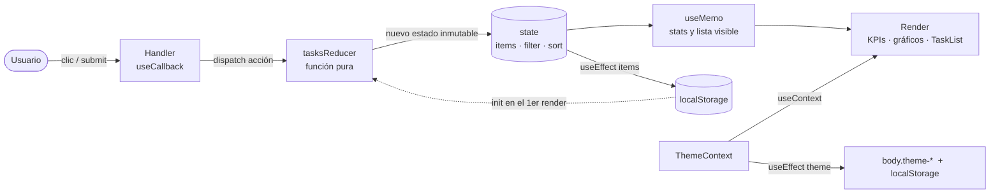
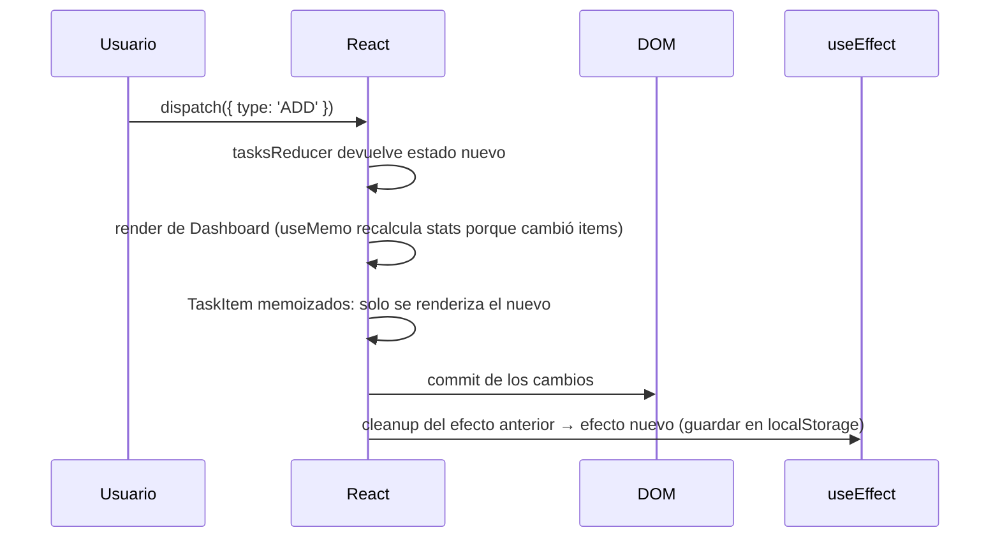

# 📊 Dashboard de Gestión con Estado Complejo

Guía Práctica Semana 07 · 2ª parte · Desarrollo de Aplicaciones Web (IS093A) · UNCP

Dashboard de tareas hecho con React + Vite que usa `useReducer`, `useContext`, `useEffect`, `useMemo`, `useCallback`, `useRef` y el hook personalizado `useLocalStorage`.

## Ejecutar

```bash
npm install
npm run dev      # servidor de desarrollo
npm run lint     # ESLint con react-hooks: debe terminar sin warnings
```

## Estructura

```
src/
├── contexts/ThemeContext.jsx   # Tema claro/oscuro global + sync con localStorage
├── hooks/useTasksReducer.js    # Reducer puro: ADD, REMOVE, TOGGLE, FILTER, SORT
├── hooks/useLocalStorage.js    # Hook personalizado reutilizable
├── components/TaskList.jsx     # Lista: useMemo, useCallback, useRef
├── components/TaskItem.jsx     # Fila memoizada con React.memo
├── components/StatCard.jsx     # Tarjetas KPI
├── components/Charts.jsx       # Dona, anillos y barras en SVG
├── App.jsx                     # Dashboard: useReducer + ThemeProvider
└── main.jsx                    # StrictMode
```

## Diagrama de flujo de estado



## Ciclo de render



## Justificación técnica de cada hook (¿por qué no un useState simple?)

| Hook | Dónde | Por qué |
|---|---|---|
| `useReducer` | `App.jsx` | El estado tiene 3 partes relacionadas (`items`, `filter`, `sort`) y varias transiciones. Con `useState` habría 3 setters y la lógica dispersa en cada handler. El reducer centraliza las reglas en una función pura, fácil de probar, y cada cambio es inmutable. |
| `useState` | `TaskList.jsx` (categoría, prioridad, error), `ThemeContext` | Estado local y simple de la interfaz que no necesita reducer. |
| `useContext` | `ThemeContext.jsx` | El tema lo usan componentes de distintos niveles. Con contexto se evita el prop drilling. Es un dato que cambia poco, así que no afecta el rendimiento. |
| `useEffect` | `ThemeContext`, `useLocalStorage`, `App` | Sincroniza con sistemas externos (localStorage, clase del `<body>`, evento `storage`). Cada efecto tiene **cleanup**: quita la clase anterior del body y elimina los listeners para evitar memory leaks. |
| `useMemo` | `App` (stats), `TaskList` (lista visible), `ThemeContext` (value) | Filtrar, ordenar y agregar datos solo cuando cambian sus dependencias. Por ejemplo, cambiar el tema **no** recalcula la lista ni las métricas. |
| `useCallback` | `App` (onAdd/onRemove/onToggle), `TaskList` (handlers a `TaskItem`), `toggleTheme` | Mantiene la misma referencia de función entre renders. Sin esto, `React.memo` en `TaskItem` no serviría, porque cada render crearía funciones nuevas. **No** se usó en `handleSubmit`, porque va a un `<form>` nativo y no a un hijo memoizado (para evitar overuse). |
| `useRef` | `TaskList` | Accede al `<input>` para darle foco al montar y después de agregar una tarea, sin provocar re-render. |
| `useLocalStorage` (personalizado) | `App` (tareas) y `TaskList` (borrador) | Encapsula leer, guardar y sincronizar entre pestañas. Se reutiliza en dos lugares con claves distintas. |

## Validación final

### 1. ESLint (cero warnings)
`npm run lint` usa `eslint-plugin-react-hooks` con `exhaustive-deps` configurado como **error** y `--max-warnings 0`. Resultado esperado: sin salida y código 0.

### 2. React DevTools Profiler
1. F12 → **Profiler** → ⚙️ → activar *"Record why each component rendered"*.
2. Grabar (●), marcar 1 tarea como completada y detener.
3. Observar que solo se re-renderiza **la `TaskItem` modificada**. Las demás aparecen en gris (*did not render*) gracias a `React.memo` + `useCallback`.
4. Grabar otra vez cambiando el filtro: las `StatCard` y los gráficos no se recalculan porque `stats` depende solo de `items`.

### 3. Cleanup activo
- En desarrollo, `StrictMode` monta, desmonta y vuelve a montar: los listeners de `storage` se agregan y quitan sin duplicarse.
- Abrir la app en **dos pestañas** y cambiar el tema o las tareas en una: la otra se actualiza sola (listener activo). Al cerrar, el cleanup lo elimina.
- Al cambiar el tema, el cleanup quita `theme-light` antes de poner `theme-dark` (F12 → Elements → `<body>`).

## Roles del equipo

| Rol | Integrante | Archivos |
|---|---|---|
| Arquitecto de Estado | _completar_ | `useTasksReducer.js`, `App.jsx` |
| Ingeniero de Efectos & Contexto | _completar_ | `ThemeContext.jsx`, efectos de `App.jsx` |
| Optimizador de Rendimiento | _completar_ | `TaskList.jsx`, `TaskItem.jsx`, Profiler |
| QA & Hook Validator | _completar_ | `useLocalStorage.js`, ESLint, README |
